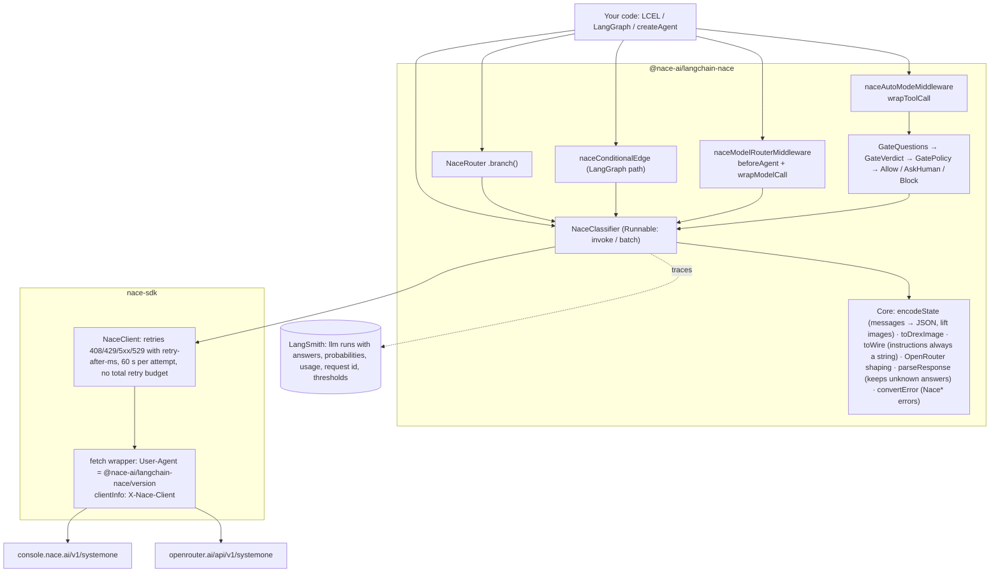
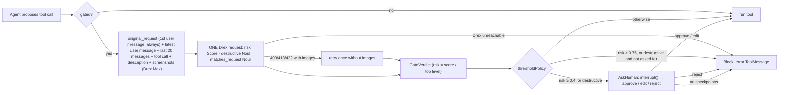

# @nace-ai/langchain-nace (JS) design

The JavaScript/TypeScript counterpart of the Python [`langchain-nace`](https://pypi.org/project/langchain-nace/): same behaviour and wire format, in LangChain.js's shape. API compatibility with `@langchain/typesafe` is a requirement: switching is an import change.

## Principles

- **No model enum.** Any model id is sent exactly as given, so new Drex releases work without a package release. The only model facts in the code are about released, pinned versions, which never change: `drex-v1.5` and `drex-v2.0` read text only, so images sent to them are refused before sending.
- **Drex is the authority on limits.** Question counts, sizes and image rules are enforced by the server; its 422 is shown with each issue's `path: message`.
- **Forward compatible.** Unknown question types, unknown answer types (`RawAnswer`), new response fields (`raw`) and new request fields (`modelKwargs`) pass through.
- **Never drop data silently.** The classifier throws on images or media it can't send. Middleware replaces unreadable media with placeholders, so a photo in the chat doesn't stop an agent.
- **Fail safe.** The tool gate blocks when Drex can't be reached; the model router escalates to the strongest model.
- **Drop-in for `@langchain/typesafe`.** Same question objects, constructor options, response fields, middleware names and options; anything TypeSafe accepts, this package accepts with the same meaning. Intentional differences are listed in the README.

## System design

`nace-sdk` sets its own `User-Agent` after merging caller headers, so the attribution `User-Agent` is set by a `fetch` wrapper handed to the SDK. The SDK's default 30 s total retry budget would skip the retry after a slow failed attempt (Drex may take 55 s), so it is turned off: `timeout` bounds each attempt and `maxRetries` their number.

## Tool gate (per tool call)

Resuming after an interrupt re-runs the hook. The decision is saved in the checkpoint as a LangGraph task, so the resume replays it on any worker: the person answers the question they were asked, and Drex isn't called twice. A changed context or policy blocks the call instead, and so does an answer that is already waiting when the gate has to decide again (after a state edit or a resume from an earlier checkpoint); a custom decision needs an `id` to be resumed. The call's input, screenshots included, is captured inside that task on a first run, so a failing screenshot source is a failed check like any other. A check that fails with `onError: "throw"` fails the run and is not recorded, so a retry captures and asks again; in runs with a `thread_id`, LangGraph doesn't let an outer middleware catch that error and continue, while without one (or outside a LangGraph run) the gate decides directly and its error is an ordinary error that outer middleware may catch. With `onError: "block"` the failure is saved and replays as the same block. On a replay the current input is captured only to compare it with the saved digest, and a call whose input can't be captured again is blocked. Replay depends on LangGraph's rule that a node calls tasks and interrupts in the same order on every run, so the gate goes before retry middleware (a retry around it can resume an earlier decision when the tool fails only sometimes), and screenshot sources must not call `task()` or `interrupt()`.

## Data model

| Type                                                        | Fields                                                                                                                                                      |
| ----------------------------------------------------------- | ----------------------------------------------------------------------------------------------------------------------------------------------------------- |
| `Noul`                                                      | `type: "noul"`, `instructions?`, `criteria?: { true?, false? }`                                                                                             |
| `Choice`                                                    | `type: "choice"`, `criteria: { label: description \| null }`, `instructions?`                                                                               |
| `Score`                                                     | `type: "score"`, `criteria: level[]` (low → high), `instructions?`                                                                                          |
| `ClassificationResponse`                                    | `model`, `answers`, `usage { inputTokens, outputTokens, imageTokens }`, `requestId`, `evaluationTimeMs`; non-enumerable `raw`, `nouls`, `choices`, `scores` |
| `NoulAnswer` / `ChoiceAnswer` / `ScoreAnswer` / `RawAnswer` | `noul` / `choice, probabilities, confidence` / `score, legend, probabilities, confidence` / `type` + any fields                                             |
| `RouteDecision`                                             | `route`, `answer: ChoiceAnswer`, `fellBack`                                                                                                                 |
| `NaceModelRoute` (agent state `modelRoute`)                 | `route`, `choice`, `confidence`, `probabilities`, `escalated`, `reason: confident \| low_confidence \| error`                                               |
| `ModelSelection` (agent state `modelSelection`)             | `model`, `selected`, `probabilities`, `fallback`, `reason`, `priority`, `candidates`, `requestId`, `latencyMs`, `anchor`                                    |
| `CandidateProfile`                                          | `provider`, `priceIn`, `priceOut`, `context`, `tags`. The candidate id is the map key, not a field of the profile.                                          |
| `GateVerdict`                                               | `risk` (0..1), `pDestructive`, `pMatchesRequest`, `response`                                                                                                |

## Wire format (what reaches Drex)

| Field            | Sent as                                                                                                             |
| ---------------- | ------------------------------------------------------------------------------------------------------------------- |
| `model`          | exactly as given (default `drex-max`, moved to the newest flagship each release)                                    |
| `state`          | string or JSON; messages as `{ role, content, tool_calls?, tool_call_id? }`; images replaced by `"[Image N]"`       |
| `questions.<id>` | `{ type, instructions: string, criteria }`; JSON instructions and criteria become JSON text                         |
| `images`         | base64 / data URL / `{ type: "workspace_file", ... }`; explicit images first, then images from messages             |
| OpenRouter       | no `images`; `state` = `[{ type: "text" }, { type: "image_url", image_url: { url: "data:..." } }, ...]`             |
| headers          | `User-Agent`, `X-Nace-Client` = `langchain-nace-js/<version>`; OpenRouter also `HTTP-Referer`, `X-OpenRouter-Title` |

## Model selection

Decision routing answers a caller-written `Choice` and picks a graph branch. Model selection calls `POST /v1/route` and picks the generative model inside the chosen agent. The documented flow is one support request: a `NaceClassifier` edge sends it to the billing agent or the support agent, and `naceModelSelectorMiddleware` selects the model that agent runs.

The selector runs in `wrapModelCall`. It does not register a `beforeAgent` hook, because on `langchain` 1.3 that hook's update shadows later state updates. The decision is a `Command` update on `modelSelection`, except when the handler returns a structured response: that object is passed through with `modelSelection` added, so `structuredResponse` is not wrapped as a message. A stored record is reused only when it is a plain object, every field is well formed and self-consistent (`reason` `selected` means `model === selected` and `fallback` is false; a true `fallback` is not `selected`; `requestId` is null or a `req_` id, `selected` is null or one of `candidates`, `candidates` is an array of strings, `probabilities` maps strings to finite numbers from 0 to 1, `fallback` is a boolean, `anchor` is a string), its `anchor` matches, and `model` is `null` or a configured id that is still eligible. `anchor` is the latest human message's id, or `count:<n>`, plus a short digest of that message's text. A new id, a new digest, or an ineligible model starts a new selection. A resumed run reads the checkpoint. When no candidate is eligible, the reason is `no_eligible_candidate` and the agent's own model runs. The fallback is kept only when it passes the same image, tool, and context checks. HTTP 408 before the local deadline is `timeout`. `NaceModelSelector.select` sends the turns it is given and does not apply the middleware's 24,000-character budget. A model that cannot be initialized fails the call with that error and does not use the fallback. The SDK client does not log route bodies.

The route body is text only: `messages`, `candidates`, and `selection_priority`. Tool calls and tool results are dropped. Images become `[image omitted]`. A latest human turn that has no real text, including an image-only turn, is `no_input` in both context modes and sends no request. The deadline discards a late response and uses the fallback. An aborted run raises the abort and does not call the handler. The price is $0.02 per 1M encoded input tokens, and only a 200 is charged. The route is not available through OpenRouter and does not run in a browser.

## NDI components

`NaceDocumentLoader` is a `BaseDocumentLoader` that turns one file (an https URL, a local path, or bytes) into `Document`s with NDI Parse: one document for the whole content (the Markdown, or the plain text when the output formats ask for `text` — a truncated `text`-only result keeps its preview, because the download link carries Markdown), or one per page or section chunk, with `source`, `job_id`, `page_count` and `chunk_id` in the metadata (`source` and the loader's own `source` field keep a URL without its query, user name and password — those parts of a signed link are credentials; only the request carries the URL exactly as given, from a private field, and `parseKwargs`, which can hold a PDF's `password`, is non-enumerable), and `page` only when the chunk has a page number. `NaceExtractTool` and `NaceSearchTool` are `StructuredTool`s with `responseFormat: "content_and_artifact"`: the content is a JSON string (extracted `data` and each field's `status`, `confidence` and `quotes`; the search `answer`, its `confidence`, its `evidences` and `exhausted`, which is `true` when the agent ran out of steps and the answer is partial) and the artifact is the raw NDI result. All three go through one internal `NdiClient`, which resolves credentials exactly like the classifier (never OpenRouter), uploads bytes with an upload token under a one-off path, creates the job, waits for it, and deletes the job and any uploaded file after the read — also after an error or a timeout. The configured `timeout` bounds the whole job: the create and the polls run under a signal that aborts at the deadline, the content download is cut at the same deadline, and a late result still fails with `NaceAPITimeoutError` — best-effort, like every deadline: a request in flight, an SDK retry or the clean-up delete can still run slightly past it. A create that ends in `503 job_pending` carries the request's `idempotencyKey` on the raised error; a tool re-invocation mints a fresh key, so resuming that job needs `nace-sdk` with the key from the error. A failed clean-up logs one `console.warn` line instead of failing the call. There is no retriever: automatic search returns one generated answer and the quotes it cites, so a tool gives the agent the answer and the evidence together.
