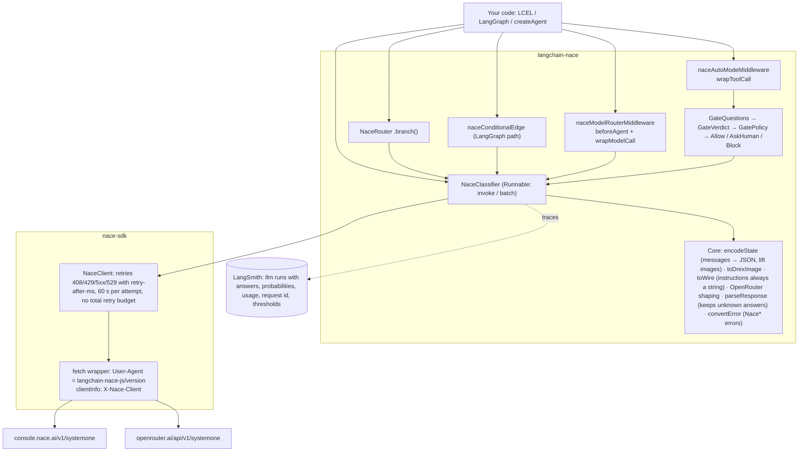
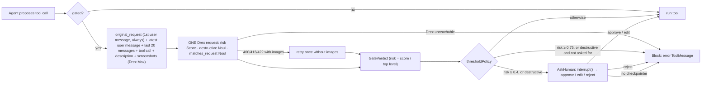

# langchain-nace (JS) design

The JavaScript/TypeScript counterpart of the Python [`langchain-nace`](https://pypi.org/project/langchain-nace/): same behaviour and wire format, in LangChain.js's shape. API compatibility with `@langchain/typesafe` is a requirement: switching is an import change.

## Principles

- **No model enum.** Any model id is sent exactly as given, so new Drex releases work without a package release. The only model facts in the code are about released, pinned versions, which never change: `drex-v1.5` and `drex-v2.0` read text only, so images sent to them are refused before sending.
- **Drex is the authority on limits.** Question counts, sizes and image rules are enforced by the server; its 422 is shown with each issue's `path: message`.
- **Forward compatible.** Unknown question types, unknown answer types (`RawAnswer`), new response fields (`raw`) and new request fields (`modelKwargs`) pass through.
- **Never drop data silently.** The classifier throws on images or media it can't send. Middleware replaces unreadable media with placeholders, so a photo in the chat doesn't stop an agent.
- **Fail safe.** The tool gate blocks when Drex can't be reached; the model router escalates to the strongest model.
- **Drop-in for `@langchain/typesafe`.** Same question objects, constructor options, response fields, middleware names and options; anything TypeSafe accepts, this package accepts with the same meaning. Intentional differences are listed in the README.

## System design

`nace-sdk` sets its own `User-Agent` after merging caller headers, so the attribution `User-Agent` is set by a `fetch` wrapper handed to the SDK. The SDK's default 30 s total retry budget would skip the retry after a slow failed attempt (Drex may take 55 s), so it is turned off: `timeout` bounds each attempt and `maxRetries` their number.

## Tool gate (per tool call)

Resuming after an interrupt re-runs the hook. The decision is saved in the checkpoint as a LangGraph task, so the resume replays it on any worker: the person answers the question they were asked, and Drex isn't called twice. A changed context or policy blocks the call instead.

## Data model

| Type                                                        | Fields                                                                                                                                                      |
| ----------------------------------------------------------- | ----------------------------------------------------------------------------------------------------------------------------------------------------------- |
| `Noul`                                                      | `type: "noul"`, `instructions?`, `criteria?: { true?, false? }`                                                                                             |
| `Choice`                                                    | `type: "choice"`, `criteria: { label: description \| null }`, `instructions?`                                                                               |
| `Score`                                                     | `type: "score"`, `criteria: level[]` (low → high), `instructions?`                                                                                          |
| `ClassificationResponse`                                    | `model`, `answers`, `usage { inputTokens, outputTokens, imageTokens }`, `requestId`, `evaluationTimeMs`; non-enumerable `raw`, `nouls`, `choices`, `scores` |
| `NoulAnswer` / `ChoiceAnswer` / `ScoreAnswer` / `RawAnswer` | `noul` / `choice, probabilities, confidence` / `score, legend, probabilities, confidence` / `type` + any fields                                             |
| `RouteDecision`                                             | `route`, `answer: ChoiceAnswer`, `fellBack`                                                                                                                 |
| `NaceModelRoute` (agent state `modelRoute`)                 | `route`, `choice`, `confidence`, `probabilities`, `escalated`, `reason: confident \| low_confidence \| error`                                               |
| `GateVerdict`                                               | `risk` (0..1), `pDestructive`, `pMatchesRequest`, `response`                                                                                                |

## Wire format (what reaches Drex)

| Field            | Sent as                                                                                                             |
| ---------------- | ------------------------------------------------------------------------------------------------------------------- |
| `model`          | exactly as given (default `drex-max`, moved to the newest flagship each release)                                    |
| `state`          | string or JSON; messages as `{ role, content, tool_calls?, tool_call_id? }`; images replaced by `"[Image N]"`       |
| `questions.<id>` | `{ type, instructions: string, criteria }`; JSON instructions and criteria become JSON text                         |
| `images`         | base64 / data URL / `{ type: "workspace_file", ... }`; explicit images first, then images from messages             |
| OpenRouter       | no `images`; `state` = `[{ type: "text" }, { type: "image_url", image_url: { url: "data:..." } }, ...]`             |
| headers          | `User-Agent`, `X-Nace-Client` = `langchain-nace-js/<version>`; OpenRouter also `HTTP-Referer`, `X-OpenRouter-Title` |
